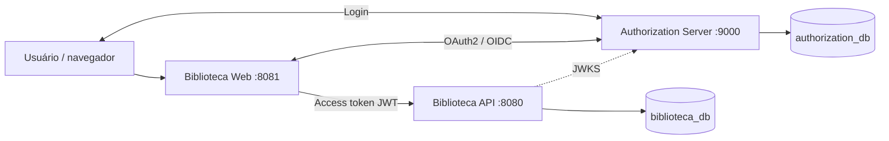

# Biblioteca — Java Back-end, OAuth2/OIDC e Docker

Sistema de gestão de biblioteca desenvolvido com **Java 21**, **Spring Boot 4.1.2** e **PostgreSQL**. O projeto é composto por três aplicações independentes: um servidor de autorização OAuth2/OIDC, uma API REST e uma interface web MVC.

## Instalação local

**Comece por [Instalação local com Docker Compose](docs/INSTALACAO_LOCAL.md).** É o único guia necessário para clonar o projeto, configurar credenciais, criar os bancos e experimentar a aplicação com login local. Não é necessário possuir um backup de banco de dados nem configurar uma conta Google.

O [índice da documentação](docs/README.md) apresenta os guias técnicos para leitura opcional.

## Arquitetura



| Aplicação | Responsabilidade | Tecnologias principais |
| --- | --- | --- |
| [`authorization-server/`](authorization-server/README.md) | Login local e, opcionalmente, Google; emissão de tokens; administração de usuários e clientes OAuth2 | Spring Security, Spring Authorization Server, PostgreSQL |
| [`biblioteca-api/`](biblioteca-api/README.md) | Operações REST de autores e livros; validação de JWT; autorização e persistência | Spring MVC, Spring Security Resource Server, JPA/Hibernate, PostgreSQL |
| [`biblioteca-web/`](biblioteca-web/README.md) | Interface HTML, login OAuth2 e acesso à API com o token do usuário | Spring MVC, Thymeleaf, OAuth2 Client |

O servidor de autorização armazena identidades em `authorization_db`; a API usa `biblioteca_db` para livros e autores. A aplicação Web não possui banco de dados próprio. No Docker Compose local, os bancos são distintos, mas utilizam a mesma instância PostgreSQL.

## Funcionalidades

- Autenticação com usuário e senha e integração opcional com Google.
- OAuth2 Authorization Code com PKCE, OpenID Connect e Client Credentials.
- API REST com pesquisa, paginação, cadastro, edição e exclusão de autores e livros.
- Interface web com formulários e mensagens de validação.
- Administração de usuários e clientes OAuth2 no Authorization Server.
- Registro de UUID de auditoria em operações de cadastro.

### Permissões

| Operação | GERENTE | OPERADOR | Cliente com `biblioteca.read` |
| --- | :---: | :---: | :---: |
| Consultar autores e livros | ✅ | ✅ | ✅ |
| Criar, editar e excluir autores | ✅ | ❌ | ❌ |
| Criar, editar e excluir livros | ✅ | ✅ | ❌ |

A API verifica assinatura JWT via JWKS, emissor (`iss`), audiência (`aud`) e validade. As autoridades de usuários (`GERENTE`, `OPERADOR`) são diferentes dos escopos utilizados por clientes de integração.

## Endereços no ambiente Docker local

| Serviço | Endereço |
| --- | --- |
| Interface Web | `http://localhost:8081` |
| Authorization Server | `http://localhost:9000` |
| API REST | `http://localhost:8080` |
| PostgreSQL, somente no computador local | `127.0.0.1:15433` |

As portas devem estar disponíveis antes da inicialização. O guia de instalação explica como verificar e resolver conflitos sem remover volumes de outros projetos.

## Tecnologias e qualidade

**Java 21 · Spring Boot 4.1.2 · Spring Security · OAuth2/OIDC · JWT · Spring MVC · Thymeleaf · Spring Data JPA/Hibernate · PostgreSQL · Docker Compose · Maven · JUnit 5 · Mockito · Testcontainers · GitHub Actions · Gitleaks · Swagger/OpenAPI**

O projeto contém testes automatizados no Authorization Server e na API, além de um workflow de integração contínua em `.github/workflows/ci.yml`.

### Executar os testes com Maven

**Pré-requisitos:** Java 21 e Maven disponíveis no terminal; o Docker Engine também deve estar ativo para os testes com Testcontainers. Execute os comandos na raiz do repositório, **um de cada vez**.

**1. Testar o Authorization Server:**

```bash
mvn -f authorization-server/pom.xml clean verify
```

**2. Testar a API:**

```bash
mvn -f biblioteca-api/pom.xml clean verify
```

**3. Verificar a aplicação Web:**

```bash
mvn -f biblioteca-web/pom.xml clean verify
```

## Documentação

- [Instalação local — guia principal](docs/INSTALACAO_LOCAL.md)
- [Índice e ordem de leitura](docs/README.md)
- [Operação Docker, logs e backup](docker/README.md)
- [Decisão arquitetural](docs/arquitetura/ADR-001-separacao.md)
- [Diagramas dos fluxos](docs/fluxos/01-login-consulta-com-3-aplicacoes.md)

## Limites do ambiente local

O Docker Compose foi preparado para desenvolvimento e demonstração no próprio computador, **não para exposição na internet**. Uma implantação pública requer, entre outros controles, HTTPS, gestão segura de segredos e persistência/rotação de chaves de assinatura JWT.
