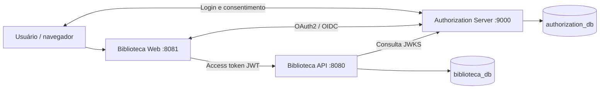

# Biblioteca — Java Back-end, OAuth2/OIDC e Docker

Sistema de gestão de biblioteca construído com **Java 21**, **Spring Boot 4.1.2** e **PostgreSQL**, organizado em três aplicações independentes: servidor de autorização OAuth2/OIDC, API REST e interface web. O projeto reúne autenticação e autorização, integração entre serviços, testes automatizados, Docker e integração contínua.

> **Status:** aplicações integradas e validadas em desenvolvimento (DEV) e homologação (HML) com Docker Compose. Pipeline de CI aprovado no GitHub Actions.

## Arquitetura



| Módulo | Responsabilidade | Tecnologias principais |
| --- | --- | --- |
| `authorization-server/` | Login local e com Google, emissão de tokens OAuth2/OIDC e administração de usuários e clientes | Spring Security, Spring Authorization Server, PostgreSQL |
| `biblioteca-api/` | Endpoints REST de autores e livros; validação de JWT; autorização; acesso aos dados | Spring Web, Spring Security Resource Server, JPA/Hibernate, PostgreSQL |
| `biblioteca-web/` | Interface MVC para consulta e manutenção do acervo; login OAuth2 e consumo da API | Spring MVC, Thymeleaf, OAuth2 Client |

A Web **não tem banco de dados próprio**. O Authorization Server e a API utilizam **bancos lógicos distintos** (`authorization_db` e `biblioteca_db`). Na HML, ambos ficam em uma instância PostgreSQL isolada dentro do Compose.

## Funcionalidades

- Login com usuário/senha e login social com Google.
- OAuth2 Authorization Code com PKCE, OpenID Connect e autenticação de clientes (`client_credentials`).
- API REST com consulta, filtros, paginação, cadastro, edição e exclusão de autores e livros.
- Interface web com formulários, validações e mensagens de erro.
- Área administrativa de usuários e clientes OAuth2 no Authorization Server.
- Auditoria de operações baseada na identificação do usuário autenticado.

### Autorização

| Ação na API | GERENTE | OPERADOR | Cliente `biblioteca.read` |
| --- | :---: | :---: | :---: |
| Consultar autores e livros | ✅ | ✅ | ✅ |
| Criar, editar e excluir autores | ✅ | ❌ | ❌ |
| Criar, editar e excluir livros | ✅ | ✅ | ❌ |

A API valida a **assinatura JWT via JWKS**, o emissor (`iss`), a audiência (`aud`) e os tempos de validade. Autoridades humanas (`GERENTE`, `OPERADOR`) são tratadas separadamente dos escopos de clientes de integração (`SCOPE_biblioteca.read`).

## Tecnologias e práticas

**Java 21 · Spring Boot 4.1.2 · Spring Security · OAuth2/OIDC · JWT · Spring MVC · Thymeleaf · Spring Data JPA/Hibernate · PostgreSQL · Docker/Docker Compose · Maven · JUnit 5 · Mockito · Testcontainers · GitHub Actions · Gitleaks · Swagger/OpenAPI**

## Executando localmente (DEV e HML)

Pré-requisitos: Java 21 e Maven para execução pelo IntelliJ; Docker Desktop com Compose v2 para homologação. Para autenticação, são necessárias credenciais de teste do Google e um cliente OAuth2 interativo previamente configurado, com seu segredo original. **Não inclua credenciais reais no Git.**

| Serviço | DEV (IntelliJ) | HML (Docker Compose) |
| --- | --- | --- |
| Authorization Server | `http://localhost:9000` | `http://localhost:9000` |
| Biblioteca API | `http://localhost:8080` | `http://localhost:8080` |
| Biblioteca Web | `http://localhost:8081` | `http://localhost:8081` |
| PostgreSQL | Porta `5432` no computador | Porta `15433` no computador; `5432` na rede Docker |

**Atenção:** DEV e HML utilizam as mesmas portas HTTP. Interrompa os aplicativos DEV antes de iniciar a HML. Os bancos PostgreSQL são independentes.

### Homologação com Docker Compose

Na raiz do repositório:

```bash
cp docker/.env.example docker/.env
```

Preencha `docker/.env` localmente, conforme as variáveis de exemplo. O arquivo real e os backups ficam ignorados pelo Git.

```bash
docker compose --env-file docker/.env -f docker/compose.yaml config --quiet
docker compose --env-file docker/.env -f docker/compose.yaml up -d postgres
```

O ambiente de homologação foi validado com bases PostgreSQL isoladas. Para iniciar com o conjunto de dados atual, prepare os bancos e os clientes OAuth2 antes de subir os serviços, seguindo o guia **[`docker/README.md`](docker/README.md)**. Os backups usados nos testes não são distribuídos no repositório por segurança.

Após preparar os bancos:

```bash
docker compose --env-file docker/.env -f docker/compose.yaml up -d --build
docker compose --env-file docker/.env -f docker/compose.yaml ps
```

Acesse a Web em **http://localhost:8081**, o painel administrativo em **http://localhost:9000/admin** e a documentação da API em **http://localhost:8080/swagger-ui/index.html**.

Para desligar os serviços sem apagar o volume PostgreSQL:

```bash
docker compose --env-file docker/.env -f docker/compose.yaml down
```

## Testes e integração contínua

Os resultados da última validação registrada foram:

- **Authorization Server:** 33 testes automatizados aprovados.
- **Biblioteca API:** 35 testes automatizados aprovados, incluindo teste de integração com PostgreSQL via Testcontainers.
- **Biblioteca Web:** build validado no pipeline; fluxos de login local/Google, consulta e edição validados manualmente em HML.
- **GitHub Actions:** workflow Maven para as três aplicações, aprovado no commit `157d94d`.
- **Gitleaks:** varredura de segredos configurada antes do `git push`.

Para executar as verificações Maven a partir da raiz do repositório:

```bash
mvn -f authorization-server/pom.xml clean verify
mvn -f biblioteca-api/pom.xml clean verify
mvn -f biblioteca-web/pom.xml clean verify
```

**O teste com Testcontainers precisa de um Docker Engine disponível.** Consulte também o workflow em `.github/workflows/ci.yml`.

## Decisões de arquitetura

- **Autenticação centralizada:** a API não realiza login nem emite tokens; atua como Resource Server stateless.
- **Autorização explícita:** endpoints protegidos com Spring Method Security e separação de roles humanas e scopes de clientes.
- **Dois bancos lógicos:** identidades/clientes OAuth2 separados dos dados de autores e livros.
- **OAuth2 no Docker:** URLs acessadas pelo navegador usam `localhost`, enquanto a comunicação entre contêineres utiliza nomes dos serviços Docker.
- **Projeto intencionalmente delimitado:** o foco está na segurança, integração, qualidade e operação.

## Próximas evoluções

- Automatizar a preparação de dados de demonstração para execução a partir de um clone limpo.
- Ampliar os testes automatizados da interface web.
- Preparar a publicação na AWS com HTTPS, gerenciamento de segredos e persistência/rotação de chaves JWT.

## Organização do repositório

```text
authorization-server/  # Autenticação, OIDC e administração
biblioteca-api/        # API REST, regras de negócio e dados
biblioteca-web/        # Aplicação MVC/Thymeleaf
docker/                # Compose, script de criação de banco e guia HML
docs/                  # Diagramas e documentos técnicos
.github/workflows/     # Integração contínua
```