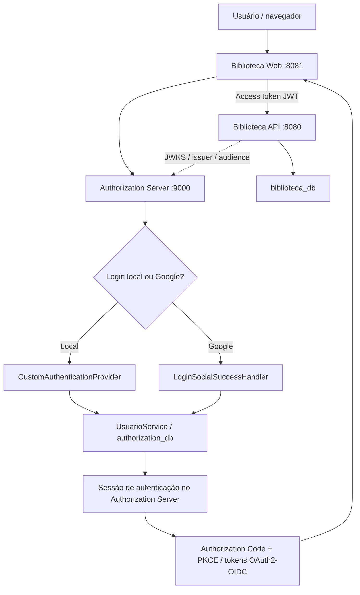

# Fluxo — Autenticação centralizada (arquitetura atual)

O Authorization Server gerencia identidade e clientes OAuth2, enquanto a API gerencia o domínio Biblioteca. A Web não armazena dados de negócio em banco próprio.
