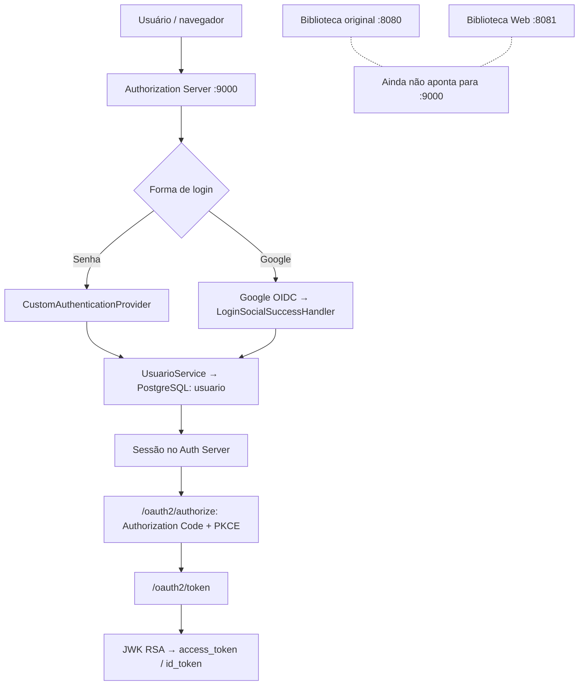

# Fluxo 03 — Authorization Server isolado (etapa 1)

Neste checkpoint, a autenticação no `:9000` é independente **como processo**, mas usa temporariamente as tabelas `usuario` e `client` do PostgreSQL antigo. A Web continua usando `:8080` até a próxima etapa. Não trocar o issuer antes de preparar a Biblioteca API.
