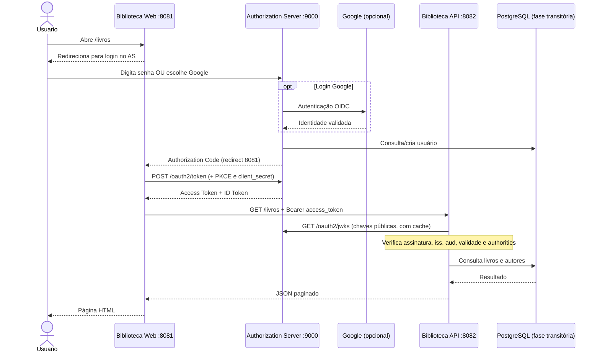

# Fluxo 01: Login e consulta com três aplicações

> Observação: a Biblioteca Web armazena tokens no lado servidor; o navegador usa um cookie de sessão.
> O JWT não é validado consultando o Authorization Server a cada requisição: as chaves JWKS são obtidas e armazenadas em cache pelo decoder.
