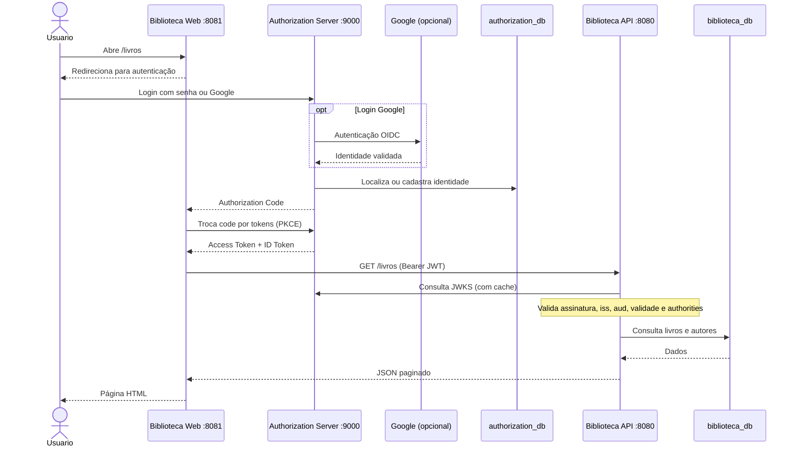

# Fluxo 01 — Login e consulta com três aplicações

O navegador inicia a autenticação pela Biblioteca Web. O Authorization Server autentica o usuário e emite tokens; a Web utiliza o access token para consultar a API. Login Google é opcional.

O Authorization Server gerencia o login e a sessão de autenticação. A Web mantém tokens no lado servidor; o navegador utiliza um cookie de sessão. A API valida os JWTs localmente com chaves obtidas por JWKS, sem solicitar introspecção a cada requisição.

Para executar o fluxo em um computador, consulte [Instalação local](../INSTALACAO_LOCAL.md).
