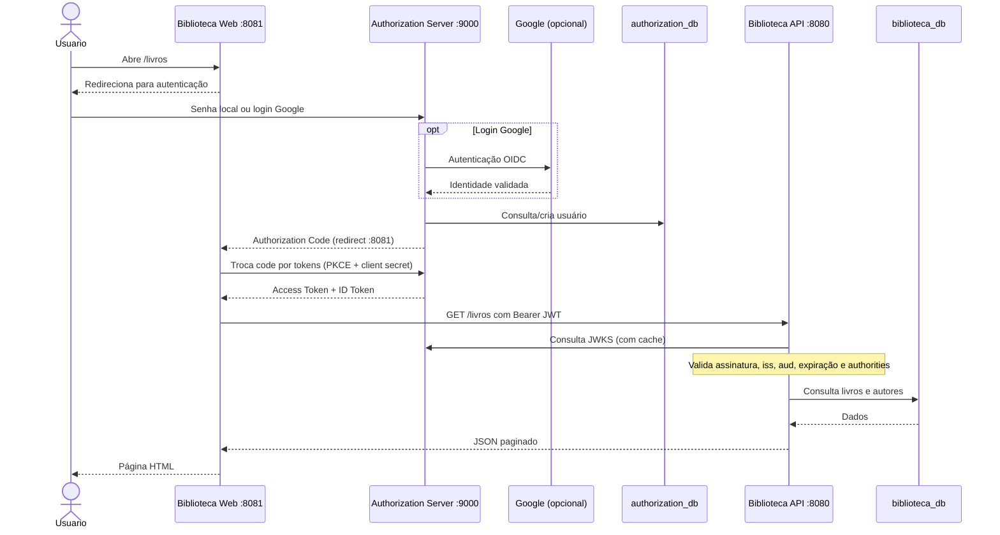

# Fluxo 01 — Login e consulta com três aplicações

A Biblioteca Web mantém os tokens do lado servidor; o navegador utiliza cookie de sessão. O Resource Server não solicita introspecção do token a cada requisição: utiliza a validação local com chaves obtidas por JWKS.
