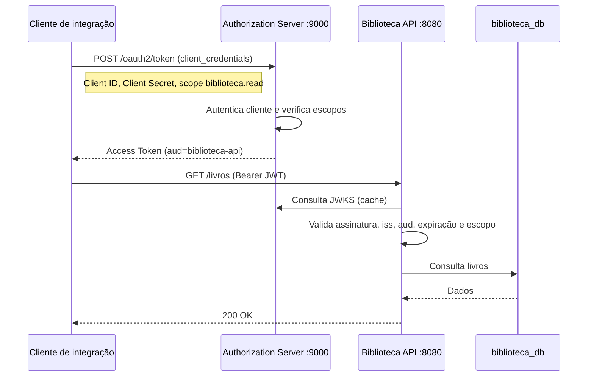

# Fluxo 02 — Integração máquina a máquina (Client Credentials)

Este fluxo é utilizado por clientes de integração autorizados a consultar a API, sem autenticação interativa de um usuário.

- `SCOPE_biblioteca.read` permite consultas aos livros e autores.
- Cadastro, edição e exclusão exigem autoridades humanas de `OPERADOR` ou `GERENTE`, conforme o recurso.
- Tokens emitidos pelo fluxo Client Credentials não recebem roles humanas.
- O cliente OAuth2 criado automaticamente na instalação local é do tipo `INTERATIVO`, para a Biblioteca Web. Para testar Client Credentials, é necessário cadastrar separadamente um cliente do tipo `INTEGRACAO` no Authorization Server.

Veja a [instalação local](../INSTALACAO_LOCAL.md) e a [descrição do Authorization Server](../../authorization-server/README.md).
