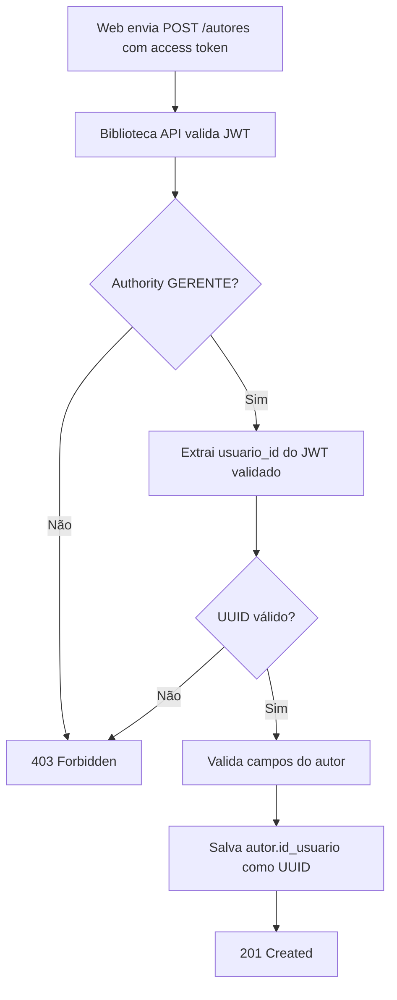

# Fluxo 03 — Auditoria por UUID, sem acoplamento com o banco de identidade

A API persiste `id_usuario` apenas como valor UUID em `biblioteca_db`. A identidade é administrada separadamente pelo Authorization Server em `authorization_db`; não existe relacionamento JPA da API com a entidade `Usuario`.
