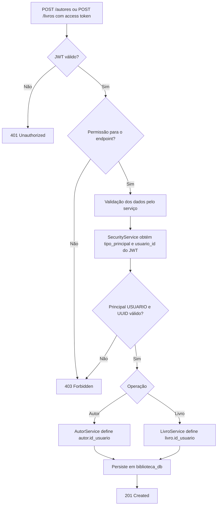

# Fluxo 03 — Identificação do responsável pelos cadastros

Este fluxo demonstra como a Biblioteca API registra o **UUID do usuário que cadastrou um autor ou livro**, sem consultar diretamente o banco de identidades do Authorization Server.

O mecanismo se aplica aos dois endpoints de cadastro:

| Operação | Permissão necessária | Campo persistido |
| --- | --- | --- |
| `POST /autores` | `GERENTE` | `autor.id_usuario` |
| `POST /livros` | `GERENTE` ou `OPERADOR` | `livro.id_usuario` |

## Origem da identidade

O Authorization Server emite o access token com a identidade do usuário. A API valida o JWT e o método `SecurityService.obterIdUsuarioLogado()` exige `tipo_principal = USUARIO` e um `usuario_id` que seja UUID válido. Os serviços `AutorService.salvar()` e `LivroService.salvar()` utilizam esse UUID no cadastro.

Em `biblioteca_db`, `id_usuario` é armazenado como um valor UUID, **sem relacionamento JPA** com a entidade `Usuario` de `authorization_db`.

## Limite da auditoria implementada

Esse campo identifica **o responsável pelo cadastro original**, e não necessariamente quem fez a última edição. As entidades também registram `data_cadastro` e `data_atualizacao`, mas o código atual não mantém um histórico completo de alterações por usuário nem um histórico de exclusões. Os métodos de atualização não substituem `id_usuario`.

Para compreender a separação de responsabilidades e bancos, consulte a [decisão arquitetural ADR-001](../arquitetura/ADR-001-separacao.md).
