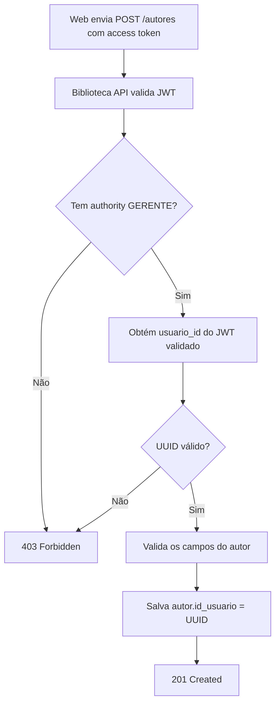

# Fluxo 03: Auditoria por UUID (sem dependência da tabela usuário)

O ID de usuário é gravado como valor UUID; não existe relacionamento JPA da API com `Usuario`.
Na fase transitória, o banco compartilhado ainda possui FKs antigas com `public.usuario`. Elas não são eliminadas automaticamente.
